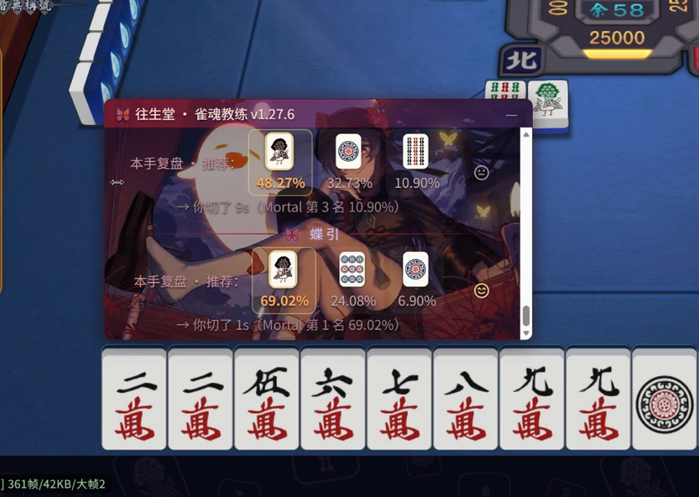

# Mahjong Soul Coach

**Let's be honest: this is cheating.**

It reads your game data and tells you the answer before you commit to a discard. With **live mode** on, it suggests a tile the moment you draw. That's cheating. I'm not going to pretend otherwise.

So it ships with two modes:

- **Live mode** — suggests on draw. Use it in a match at your own risk.
- **Review mode (default)** — speaks only after you discard. For practice.

Runs locally. No telemetry. No auto-play. No certificate install.

## Why install this one

1. **It just works.** No Python, no MITM certificate, no system proxy, no bundled browser. One installer, four-step wizard.
2. **It doesn't touch your table.** Reads data, draws an overlay. Never clicks, never injects, never patches the client.
3. **Real strength.** Full Mortal-S42 weights (192×40), not the lite model. Tens of milliseconds per decision, all on your CPU.

Compared with auto-play tools (e.g. MahjongCopilot):

| | This | Auto-play tools |
|---|---|---|
| Plays for you | No | Yes |
| MITM certificate | No | Yes |
| System proxy | No | Yes |
| Default timing | After your discard | Live, step-by-step |

That's not "safe" — it just means three fewer things that can break on your machine.

## Install

1. [Download](https://github.com/fanpaisk/mjsoul-teacher/releases/latest) `MahjongSoulCoach-Setup-1.1.0.exe`
2. Double-click (unsigned; SmartScreen → More info → Run anyway)
3. Tray icon → wizard (4 clicks)

## Risk

Reading game data sits at the edge of the Mahjong Soul ToS. **I can't promise you won't get banned.** My advice: don't use it in ranked. Practice in a friend room.

---

Mortal-S42 (Apache-2.0) · libriichi · PyTorch · open source
