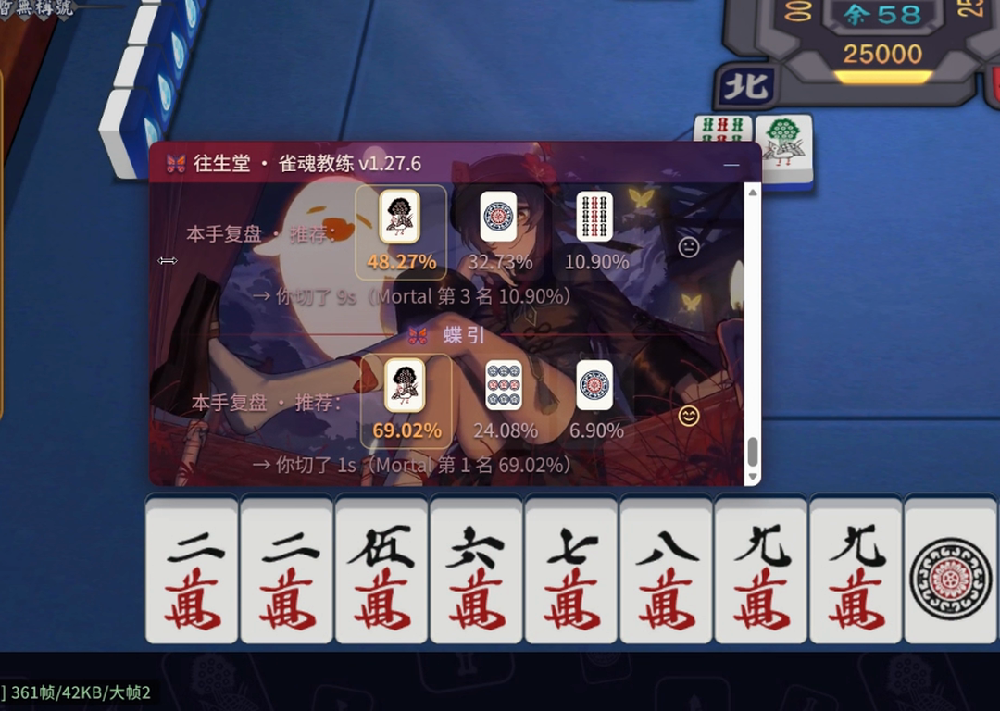
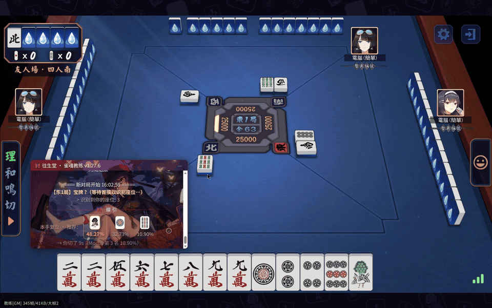

# 雀魂コーチ · Mahjong Soul Coach

[中文](README.md) · [English](README.en.md) · [日本語](README.ja.md) · [한국어](README.ko.md)

**下载了觉得还行的姥爷们，顺手点个star⭐呗，或者分享一下吧QAQ**

**有什么问题和修改建议都可以开 [Issue](https://github.com/fanpaisk/mjsoul-teacher/issues)哦**

**中国語 / English / 日本語 / 한국어 の4言語対応**（設定ページで切替）

**はっきり言います：これはチートツールです。**

対局データを読み、打牌を決める前に答えを出します。リアルタイムモードをオンにすれば、ツモった瞬間に「何を切るか」を表示します。ごまかしません。

だからモードは2つあります：

- **リアルタイムモード**：ツモ即提案。対局で使うなら自己責任。
- **復盤モード（既定）**：打ち終わってから表示。練習向け。

ローカル実行・外部通信なし・自動打牌なし・証明書インストール不要。

  

152 MB · 管理者権限不要 · Chrome/Edge + Tampermonkey · Windows 10/11

## インストールする理由

1. **入れてすぐ使える。** Python 不要、MITM 証明書不要、システムプロキシ変更不要、専用ブラウザ不要。インストーラーと4ステップのウィザードだけ。
2. **牌桌に触らない。** データを読んでパネルに描くだけ。クリックも注入もしません。打牌はあなたの手。
3. **牌効率は本物。** Mortal-S42 の完全な重み（192×40）。1手あたり数十ミリ秒、すべてローカル CPU。

自動打牌系ツールとの違いは検証可能です：

| | 本ツール | 自動打牌系 |
|---|---|---|
| 代わりに打つ | いいえ | はい |
| MITM 証明書 | 不要 | 必要 |
| システムプロキシ | 変更しない | 変更する |
| 既定のタイミング | 打牌後に表示 | 常時リアルタイム |

**安全という意味ではありません。** 壊れる箇所が3つ少ない、というだけです。

## 対応サーバー

検証済み：国際中文服（`game.maj-soul.com`）、日本語服（`game.mahjongsoul.com`）。

英語服（`mahjongsoul.game.yo-star.com`）はスクリプトの対象に追加済みですが、**実機検証はまだ**です。フレーム数が増えない場合は Issue で知らせてください。

## インストール
1. [ダウンロード](https://github.com/fanpaisk/mjsoul-teacher/releases/latest) `MahjongSoulCoach-Setup-1.2.0.exe`
2. ダブルクリック（未署名。SmartScreen は「詳細情報 → 実行」）
3. トレイアイコン → ウィザード（4クリック）

困ったら [Issue](https://github.com/fanpaisk/mjsoul-teacher/issues) へ。

## 最後に：リスクは自己責任

対局データを読む行為は、雀魂の利用規約に触れる可能性があります。**BAN されない保証はできません。**

おすすめは一つだけ：**段位戦では使わないこと。** 練習したいなら友人戦で思考時間を長めに設定し、毎手自分で考えてから比較してください。

---

Mortal-S42 (Apache-2.0) · libriichi · PyTorch
