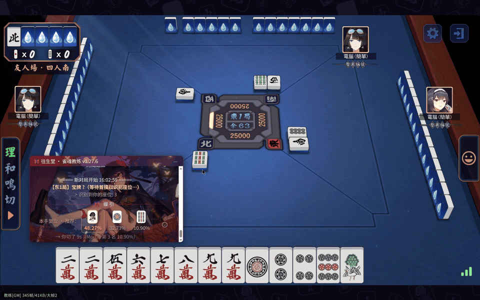

# 작혼 코치 · Mahjong Soul Coach

[中文](README.md) · [English](README.en.md) · [日本語](README.ja.md) · [한국어](README.ko.md)

**下载了觉得还行的姥爷们，顺手点个star⭐呗，或者分享一下吧QAQ**

**有什么问题和修改建议都可以开 [Issue](https://github.com/fanpaisk/mjsoul-teacher/issues)哦**

**중국어 / English / 日本語 / 한국어 4개 언어 지원** (설정에서 전환)

**분명히 말합니다: 이건 치트 도구입니다.**

대국 데이터를 읽고, 버리기 전에 답을 줍니다. 실시간 모드를 켜면 패를 뽑는 순간 무엇을 버릴지 표시합니다. 포장하지 않겠습니다.

그래서 모드가 두 개입니다:

- **실시간 모드**: 뽑자마자 추천. 대국에서 쓴다면 위험은 본인 부담.
- **복기 모드(기본)**: 버린 뒤에 표시. 연습용.

로컬 실행 · 외부 통신 없음 · 자동 타패 없음 · 인증서 설치 불필요.

## 설치할 이유

1. **설치하면 바로 됩니다.** Python 불필요, MITM 인증서 불필요, 시스템 프록시 변경 불필요, 전용 브라우저 불필요. 설치 파일 + 4단계 마법사.
2. **패桌을 건드리지 않습니다.** 데이터를 읽어 패널에 그릴 뿐, 클릭도 주입도 하지 않습니다. 타패는 당신의 손.
3. **패효율은 진짜입니다.** Mortal-S42 전체 가중치(192×40). 한 수 수십 밀리초, 전부 로컬 CPU.

자동 타패 도구와의 차이는 검증 가능합니다:

| | 이 도구 | 자동 타패류 |
|---|---|---|
| 대신 침 | 아니오 | 예 |
| MITM 인증서 | 불필요 | 필요 |
| 시스템 프록시 | 변경 안 함 | 변경함 |
| 기본 타이밍 | 버린 뒤 | 항상 실시간 |

**안전하다는 뜻은 아닙니다.** 문제가 생길 곳이 세 군데 적다는 것뿐입니다.

## 지원 서버

검증됨: 국제 중국어 서버(`game.maj-soul.com`), 일본어 서버(`game.mahjongsoul.com`).

영어 서버(`mahjongsoul.game.yo-star.com`)는 스크립트에 포함했지만 **실기 검증은 아직**입니다. 프레임이 늘지 않으면 Issue 로 알려 주세요.

## 설치
1. [다운로드](https://github.com/fanpaisk/mjsoul-teacher/releases/latest) `MahjongSoulCoach-Setup-1.2.0.exe`
2. 더블클릭 (서명 없음. SmartScreen 은 「추가 정보 → 실행」)
3. 트레이 아이콘 → 마법사 (4번 클릭)

문제가 있으면 [Issue](https://github.com/fanpaisk/mjsoul-teacher/issues) 로.

## 실행 방법

설치 마지막 화면에서 「실행」이 기본 체크되어 있습니다. 완료되면 트레이에 동그란 아이콘이 생깁니다
(Windows 11 에서는 `^` 안에 숨겨져 있을 수 있습니다).

**이후에는 매번**:

1. **시작 메뉴 → 작혼 코치** (설치 시 바탕화면 바로가기 생성 가능)
2. 트레이 아이콘 우클릭 → 시작/중지, 설정 마법사, 설정, 로그

> 자동 시작은 **하지 않습니다**(설계상). 재부팅 후에는 시작 메뉴에서 직접 실행하세요.

## 마지막으로: 위험은 본인 부담

대국 데이터를 읽는 행위는 작혼 이용약관에 저촉될 수 있습니다. **차단되지 않는다고 보장할 수 없습니다.**

권장은 하나뿐입니다: **등급전에서는 쓰지 마세요.** 연습하려면 친선전에서 생각 시간을 길게 두고, 매 수 스스로 고민한 뒤 비교하세요.

---

Mortal-S42 (Apache-2.0) · libriichi · PyTorch
