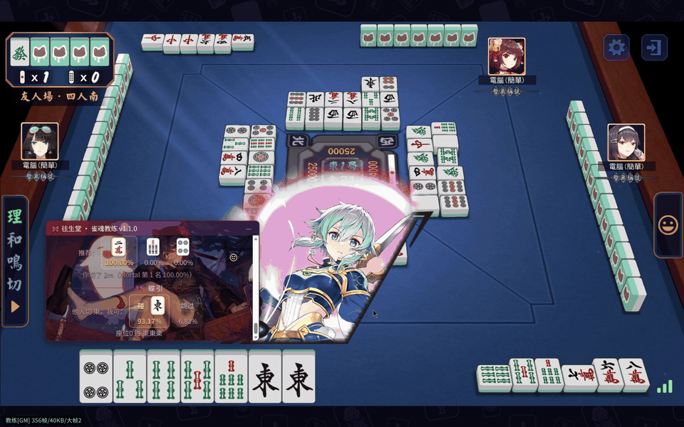
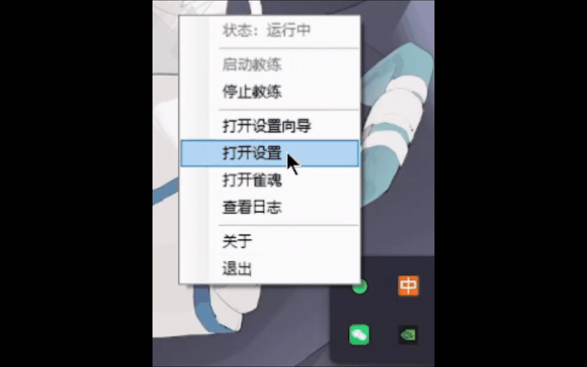

# 雀魂教练 · Mahjong Soul Coach

**先说清楚：这东西是作弊。**

它读你的对局数据，在你做决定之前给答案。开了**实时模式**，你摸牌它就说打哪张——这就是作弊，我不洗。

所以它有两个模式，你自己选：

- **实时模式**：摸牌即建议。对局用，风险自负。
- **复盘模式（默认）**：切完牌才说话。练牌用，不干扰决策。

本地跑、不联网、不点牌、不装证书。

  

152 MB · 免管理员 · Chrome/Edge + Tampermonkey · Windows 10/11

## 它凭什么值得装

**1. 装完就能用。** 不用装 Python、不用装证书、不用改系统代理、不用自带浏览器。一个安装包，四步向导。

**2. 不碰你的牌桌。** 只读数据、只画面板，不点击、不注入、不改客户端。点哪张牌永远是你自己的手。

**3. 牌效是真家伙。** Mortal-S42 完整权重（192×40），不是精简版。每手几十毫秒，全在本机 CPU。

和自动打牌类工具（比如 MahjongCopilot）比，差异是可验证的：

| | 这个 | 自动打牌类 |
|---|---|---|
| 替你出牌 | 不 | 会 |
| 装 MITM 证书 | 不装 | 要装 |
| 改系统代理 | 不改 | 要改 |
| 默认时机 | 切完牌才说话 | 逐步实时 |

少了这三样**不等于安全**，只等于系统里少三个会出问题的地方。

**实时模式**（摸牌即提醒，设置里手动开，风险自负）：

## 托盘程序图标

装完托盘里就一个图标：绿色 = 运行中，右键是全部入口（启动/停止、向导、设置、日志）。

## 安装

1. [下载](https://github.com/fanpaisk/mjsoul-teacher/releases/latest) `MahjongSoulCoach-Setup-1.1.0.exe`
2. 双击（没签名，SmartScreen 点「更多信息 → 仍要运行」）
3. 托盘右键 → 向导，点四下：环境自检 → 模型（自带）→ 装脚本 → 进游戏

卡住就开 [Issue](https://github.com/fanpaisk/mjsoul-teacher/issues)，或设置页导出诊断包。

## 最后，风险自负

读对局数据这件事，本身就踩在《雀魂用户协议》的边上。**我不承诺你不会被封**，也给不了任何保证。

我的建议只有一句：**别在段位场用。** 要练，就在友人场开个练习房，把思考时间拉长，每一手先自己想完、再切，最后对照 AI 怎么打。

---

Mortal-S42（Apache-2.0）· libriichi · PyTorch · 代码开源，模型致谢见 [CHANGELOG](CHANGELOG.md)
