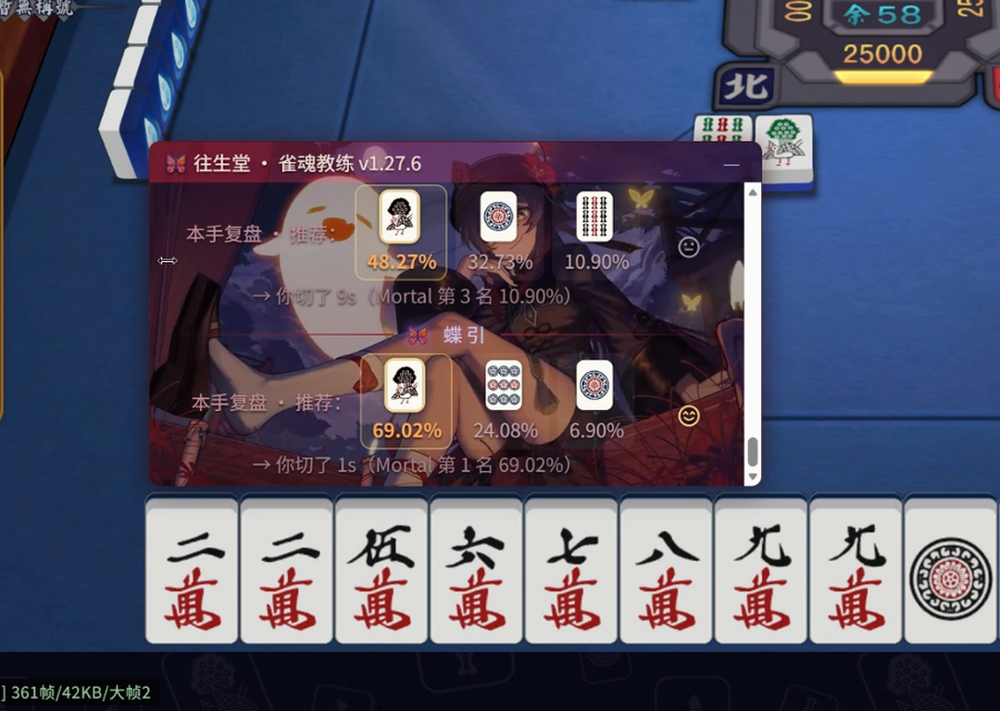
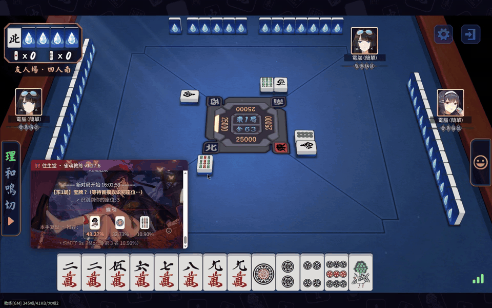
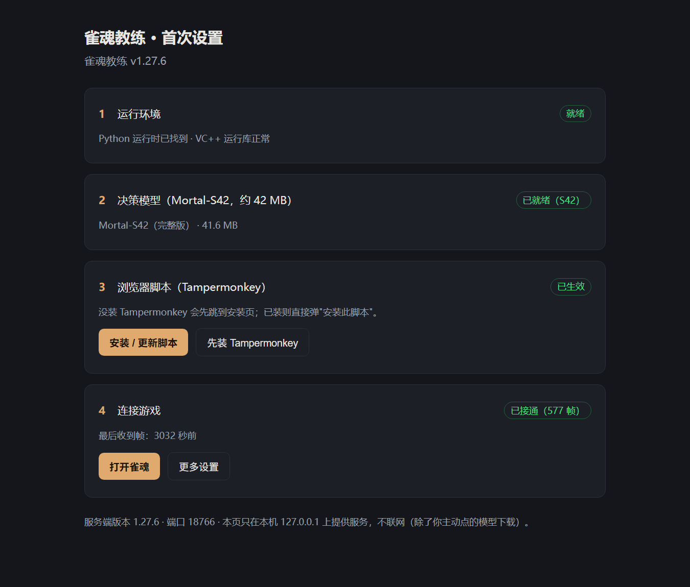

# 雀魂教练 · Mahjong Soul Coach

**建议只在友人场使用，或者自己开个练习场把思考时间拉长，每一手都先想完再切、再对照复盘。**

**切完牌，悬浮面板告诉你：AI 会怎么打、你这一手差了多少。装完就能用——不装证书、不走代理、不点击牌桌。**

默认是**复盘模式**（先做决策，再看评价）；想要摸牌就给建议的**实时模式**，设置里自己开——那是局中辅助，风险自负，见「提醒时机」。

  

  152 MB · 免管理员 · 需要 Chrome/Edge + Tampermonkey

> ⚠️ **使用前必读**
>
> 使用第三方工具读取游戏数据，本身就存在违反《雀魂用户协议》的可能。本项目仅供学习研究，
> **请勿在段位场使用，风险自负**。
>
> - **它不替你打牌**：不点击牌桌、不发送游戏请求、不修改客户端，只把对局数据读出来在本机算。
> - **默认不预判**：复盘模式下，从你摸牌到你切牌，面板上什么都没有。
> - **实时模式是另一个选择**：开了它，面板会在你切牌前给出建议——那是局中辅助，介入更深。默认关闭，开了自己承担。

---

## 三个真正不同的地方

同类工具里 star 最多的是 [MahjongCopilot](https://github.com/latorc/MahjongCopilot)：它做**自动打牌**——自带浏览器、MITM 代理、模拟点击、自动开下一局。强，但那是另一条路。

本项目走的是另一条：

**1. 装完就能用，不碰你的系统**
不需要装 Python、不需要装证书、不需要改系统代理、不需要自带浏览器。一个安装包，四步向导，托盘一个图标。

**2. 不点击、不注入、不改客户端**
它只读对局数据，算出结果，画在悬浮面板上。点哪张牌永远是你自己的手。

**3. 默认复盘，不是实时**
你切完牌，它才说话。慢一拍，但那一拍恰好是你该自己想的。

### 关于「哪个更安全」

先说清楚：**谁也不敢保证不被封**。两者都要读对局数据，这一层风险躲不掉。

但有些差异是可验证的：

| | 本项目 | 自动打牌类工具 |
|---|---|---|
| 系统证书（MITM） | **不装** | 要装，且要信任 |
| 系统代理 | **不改** | 要改（或自带浏览器走代理） |
| 模拟点击 / 注入进程 | **没有** | 有（自动出牌） |
| 网络请求 | 只发生在本机 `127.0.0.1` | 经过中间人代理 |
| 默认时机 | 切完牌才说话 | 逐步实时指导 |

少了上面那几样，**不等于安全，只等于风险面小一类**。但对一个要长期用的工具来说，这一类的差别不小：
系统里少一个被信任的证书、少一个后台进程、少一次模拟点击，出问题时你能查的地方就少一处。

我们不承诺「不会被发现」，只承诺「我们没做那些事」。

## 强度：不是给新手用的简化版

用的是 **Mortal-S42 完整权重**（192 通道 × 40 残差块，41.6 MB），不是精简版——牌效判断按高段位的标准来，
不会出现「因为模型小，所以给你一个粗建议」的情况。每手几十毫秒，全在本机 CPU 上算。

所以它适合的恰恰是**已经打得不错、还想再抠细节的人**：魂天、圣、豪，都能从「这一手亏了多少」里拿到东西。
新手也能用，但最值钱的是那些「我以为打对了」的瞬间。

## 提醒时机（两种模式）

| 模式 | 行为 | 适合谁 |
|---|---|---|
| **复盘模式（默认）** | 你切完牌，面板才给出这一手的候选打法和你的名次 | 想练牌、不想被答案带着走 |
| **实时模式（手动开启）** | 你摸到牌，面板立刻给出建议 | 只想快点看 AI 怎么想；**局中辅助，风险自负** |

切换：设置页 →「提醒时机」→ 选好 → 保存 → 重启教练（托盘右键 停止/启动）。

> 开实时模式时，设置页和启动日志都会显式警告一次。这不是免责仪式——**它确实比复盘模式更像作弊**。
> 段位场别开；要用就在友人场或自建练习场。

## 30 秒看效果

| 你看到的 | 含义 |
|---|---|
| 候选打法 + 百分比 | AI 认为从最优到次优的选择，越靠左越接近最优 |
| 下方「你切了 X（Mortal 第 N 名）」 | 你的实际选择在 AI 眼里排第几 |
| 左下角 `教练 N 帧` | 数据接通状态；不涨就是没连上 |

> 上图与动图都来自**友人场**。

## 和常见方案的区别

- **牌谱屋**：事后统计，要上传牌谱，回答的是「我整体打得怎么样」，不是「这一手该打什么」
- **云端 AI 复盘**：要联网、通常要付费，对局数据要离开你的电脑
- **本项目**：装一次，之后全程离线；给的是「这一手」的即时评分，不是赛后报告
- **自动打牌类工具**：替你出牌，省事但介入最深；本项目不点击

（各家功能以官方说明为准，这里只说定位差异。）

## 它做什么

| | |
|---|---|
| **本地推理** | 内置 Mortal-S42 神经网络（192 通道 × 40 残差块），每手几十毫秒，零云端 |
| **全时机评分** | 切牌、吃、碰、杠、荣和、加杠抢杠——每个合法操作（含"跳过"）都有评分 |
| **两种时机** | 默认复盘（切完才说）；实时模式可选，风险自负 |
| **游戏内面板** | 可拖动、可折叠、天凤风格牌面，位置自动记忆 |
| **隐私三档** | F9 隐藏 / 默认黑牌（按住查看）/ 点击全部变黑 |
| **断线自愈** | 重连后按牌山计数去重重放，引擎状态无缝续上 |

## 它不是什么

- 不是自动打牌机器人：**不点击牌桌、不发送游戏请求、不修改客户端文件**
- 不是云服务：没有账号、没有遥测、没有任何数据上传
- 默认不是实时提示器：**复盘模式下你切牌之前面板保持沉默**；实时模式要你自己打开，且风险自负

## 安装（Windows 10/11）

**前置条件**：Chrome 或 Edge 浏览器 + [Tampermonkey](https://www.tampermonkey.net/) 扩展
（新版 Chrome 还需在扩展详情页打开"允许用户脚本"和开发者模式）。

1. 到 [Releases](https://github.com/fanpaisk/mjsoul-teacher/releases/latest) 下载最新的
   `MahjongSoulCoach-Setup-x.y.z.exe`（约 152 MB，打包了 PyTorch 运行时，所以大）
2. 双击安装。Windows 会提示"未知发布者"（安装包没有代码签名），点 **更多信息 → 仍要运行**
3. 装完托盘出现圆形图标 = 成功（免管理员，装到 `%LOCALAPPDATA%\MahjongSoulCoach`）

> 装不上 / 被杀软拦？看下面「常见问题」，或到 [Issues](https://github.com/fanpaisk/mjsoul-teacher/issues) 贴日志。

## 第一次使用

装完双击托盘图标，会打开设置向导（`http://127.0.0.1:18766/setup`），四步：

| 步骤 | 你要做的 |
|---|---|
| 1 运行环境 | 无需操作，自动检查 |
| 2 决策模型 | 已内置；缺失时点"下载模型"（约 42 MB） |
| 3 浏览器脚本 | 点"安装/更新脚本"，在 Tampermonkey 弹窗里确认 |
| 4 连接游戏 | 打开雀魂并进入对局，看到"已接通（N 帧）"即完成 |

## 日常使用

**托盘图标右键**：启动 / 停止教练、设置向导、设置、打开雀魂、查看日志、关于。
图标颜色：绿色 = 运行中，灰色 = 已停止。

**面板**：

| 操作 | 方式 |
|---|---|
| 移动 / 改宽度 | 拖标题栏 / 拖左边缘的橙色把手 |
| 隐藏显示 | **F9** |
| 黑牌 | 设置页开启；按住单张牌临时查看 |
| 全部变黑 | 点任意牌面（直播防偷看），再点恢复 |
| 换背景 | 设置页 →「面板壁纸」上传 mp4/webm/png/jpg/gif（≤64 MB），刷新游戏页生效 |
| 面板跑出屏幕 | 点左下角 `教练 N帧` 角标，一键归位 |

## 常见问题

| 症状 | 处理 |
|---|---|
| 角标帧数不涨 / 面板不出现 | 托盘图标是不是绿色？重开一次游戏页 |
| 提示"脚本版本过旧" | 向导第 3 步重新安装脚本 |
| 提示"缺少模型" | 向导第 2 步下载（42 MB） |
| 提示"端口被占用" | 托盘 → 停止；仍不行就重启电脑 |
| 杀毒软件报毒 | 未签名 exe 的常见误报，加白名单或换便携版 |
| 实时模式没生效 | 设置页保存后要**重启教练**，再刷新游戏页 |
| 其他问题 | 设置页 → **导出诊断包**，把 zip 发到 Issues |

## 隐私与安全

- 只监听 `127.0.0.1`，局域网连不上；不联网（仅"检查更新"和"下载模型"两处，都由你点）
- 不上传任何数据，无遥测、无账号、无云端推理
- 服务端校验 `Host` / `Origin`，其他网页对本地端口的访问一律拒绝
- 模型下载带 SHA256 校验；不需要管理员权限；不做开机自启
- 细节与漏洞报告方式见 [SECURITY.md](SECURITY.md)

## 开发与打包

见 [DEVELOPING.md](DEVELOPING.md)。版本变更见 [CHANGELOG.md](CHANGELOG.md)。

## 我的其他工具

- [减仓计算器](https://github.com/fanpaisk/jiancang) — 纯前端、零后端的基金减仓试算器
- [DSH 微信提醒](https://github.com/fanpaisk/dsh-pushplus-notify) — AI 任务跑完推送到微信

## 致谢

推理网络 [Mortal](https://github.com/Equim-chan/Mortal) 架构与社区权重
[Mortal-S42](https://huggingface.co/haor/Mortal-S42)（Apache-2.0）、麻将规则库
[libriichi](https://github.com/Equim-chan/libriichi)、推理运行时 PyTorch（BSD）。

本项目不含任何游戏素材；背景视频、表情包等主题素材由用户自备。

---

如果它帮你少点了一炮，点个 ⭐ 就是最好的支持。
